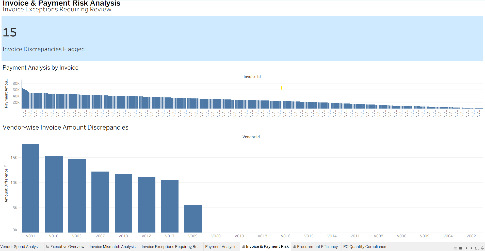
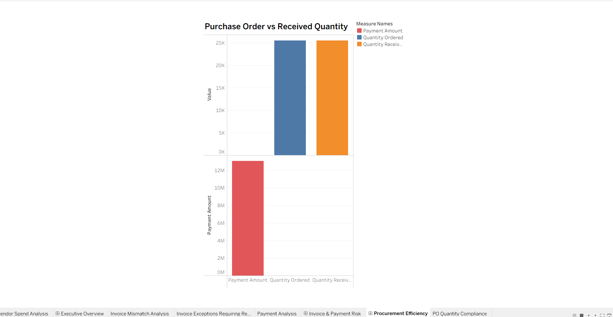

# Procurement Spend and Vendor Risk Analytics

## Project Overview
An end-to-end procurement analytics project focused on purchase-to-pay (P2P) spend analysis, vendor monitoring, invoice exception detection, duplicate invoice identification, and procurement risk visibility.

The project uses synthetically generated procurement data to demonstrate how Python, SQL, and Tableau can support procurement operations, financial controls, and data-driven decision-making.

## Business Objectives
- Analyze procurement spend across vendors.
- Identify high-spend vendors and monitor spend concentration.
- Detect invoice amounts exceeding purchase order amounts.
- Identify duplicate invoice records.
- Analyze procurement exceptions and potential control weaknesses.
- Present findings through dashboards and management recommendations.

## Tools and Technologies
- **Python:** Synthetic data generation, data cleaning, spend analysis, and anomaly detection.
- **SQL (SQLite):** Data querying, validation, and exception analysis.
- **Tableau:** Procurement dashboards and data visualization.
- **Excel:** Initial data exploration and validation.
- **Draw.io:** Procure-to-Pay process mapping.
- **ChatGPT:** AI-assisted interpretation of analytical findings and development of management recommendations, with human review.

## Dataset
The project uses synthetic procurement datasets:

| Dataset | Records |
|---|---:|
| Vendors | 20 |
| Purchase Orders | 500 |
| Receipts | 500 |
| Invoices | 510 |
| Payments | 510 |

## Key Findings
- Total purchase order spend: 12,744,797 (currency not specified).
- Highest-spend vendor: V003, with 983,439 across 34 purchase orders.
- 15 invoices flagged where invoice amounts exceeded purchase order amounts.
- 10 unique duplicated invoice IDs identified, resulting in 20 rows in the duplicate-invoice review file.

These are analytical review flags in synthetic data. They do not establish fraud, financial loss, or actual vendor misconduct.

## Tableau Dashboards
The project includes three dashboards:

1. **Executive Overview:** Vendor spend and invoice exception visibility.
2. **Invoice & Payment Risk:** Invoice discrepancy KPI, vendor-wise discrepancies, and payment analysis.
3. **Procurement Efficiency:** Purchase order versus received quantity analysis.

Dashboard screenshots and the packaged Tableau workbook are available in the `tableau/` directory.

## Python and SQL Analysis
- Vendor spend analysis.
- Invoice amount mismatch detection.
- Duplicate invoice identification.
- Anomaly detection analysis.
- SQL-based validation and summary reporting.

## AI-Assisted Management Insights
The analytical findings were used as inputs for AI-assisted interpretation and management recommendations, including:
- Duplicate invoice prevention controls.
- Automated three-way invoice matching.
- Exception-based investigation.
- Risk-based payment approvals.
- Vendor spend monitoring and management KPIs.

See `docs/AI_Assisted_Procurement_Insights.txt` for the report. Recommendations require human validation before implementation.

## Project Structure
- `data/` – Raw and processed synthetic datasets.
- `python/` – Data generation and analysis scripts.
- `sql/` – SQL queries and SQLite database.
- `tableau/` – Packaged Tableau workbook and dashboard screenshots.
- `process/` – Procure-to-Pay process map.
- `docs/` – Project worklog and AI-assisted insights report.
- `alteryx/` – Reserved for potential future Alteryx materials.

## Business Value
This project demonstrates how procurement data can be transformed into actionable insights to improve spend visibility, identify invoice exceptions, monitor vendor concentration, and strengthen financial review processes.

## Data Disclaimer
All datasets are synthetically generated for learning and portfolio demonstration purposes. They do not represent actual company, supplier, or transaction records. Anomalies were intentionally introduced for testing detection logic.
## Tableau Dashboard Screenshots

### Executive Overview

### Invoice & Payment Risk

### Procurement Efficiency

### Additional Worksheet Visualizations
- [Vendor Spend Analysis](tableau/Vendor_Spend_Analysis.png)
- [Invoice Discrepancy KPI](tableau/Invoice_Discrepancy_KPI.png)
- [Invoice Mismatch Analysis](tableau/Invoice_Mismatch_Analysis.png)
- [Payment Analysis by Invoice](tableau/Payment_Analysis_by_Invoice.png)
- [Purchase Order Quantity Compliance](tableau/PO_Quantity_Compliance.png)

**Packaged Tableau Workbook:** [Procurement_Spend_Risk_Analytics.twbx](tableau/Procurement_Spend_Risk_Analytics.twbx)
